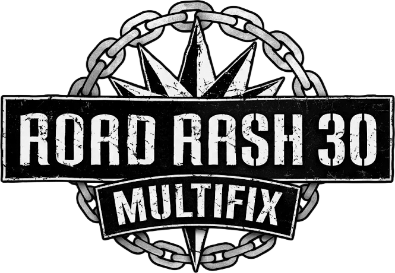

<p align="center"></p>

<p align="center"><b>v2.14.2</b> &nbsp;|&nbsp; <a href="https://github.com/magoowa/RoadRash30-MultiFix/releases/latest"><b>Download the latest release</b></a> &nbsp;|&nbsp; <a href="CHANGELOG.md">Changelog</a></p>

Fixes, widescreen and a Direct3D 11 renderer for **Road Rash: 30th Anniversary Edition** (GOG, EA app and Steam). Authors: **OBLPlife** (original author) and **magoowa**.

A GOG-compatible rework of [OBLPlife/RoadRash30th-HD](https://github.com/OBLPlife/RoadRash30th-HD) for the GOG, EA app and Steam editions.

**`RoadRash95.exe` is never modified.** The patch is a `ddraw.dll` proxy that the game loads from its own folder. It forwards all DirectDraw calls to the real system `ddraw.dll` and loads `RoadRashMultiFix.dll` at startup. The renderer checks the game code before hooking and does nothing on an executable it does not recognize (see `RoadRashHD.log`). Verified with the GOG build `60184028392664413` (SHA-256 `9e40e25737149ab095061b7154797a35495faea97644fafc5a1e616f1400c968`), which is byte-identical to the Steam build 26105967.


## Install and Restore

1. Download `RoadRash30-MultiFix_v<version>.zip` from the [latest release](https://github.com/magoowa/RoadRash30-MultiFix/releases/latest) and unpack `RoadRash_MultiFix_Setup_v<version>.exe` (or build it yourself, see below). You can place it in the game folder, next to `RoadRash95.exe`, or run it from anywhere and pick the folder.
2. Double-click the EXE and select **Install**. If the game is in `C:\Program Files` or `C:\Program Files (x86)`, right-click the EXE and choose **Run as administrator**.
3. Launch the game as usual (GOG Galaxy or the desktop shortcut). Resolution is detected automatically; adjust it under **Graphics and Sound → Race Resolution** if desired.

Install copies `ddraw.dll`, `RoadRashMultiFix.dll` and (if missing) `RoadRashHD.ini` into the game folder. If you already have a different `ddraw.dll` there, it is saved to `ResolutionPatch_Backup` and put back on **Restore**. To restore, open the same EXE and select **Restore**, or run it with `/restore`. `/quiet` suppresses dialogs. You can also remove the patch by simply deleting `ddraw.dll` and `RoadRashMultiFix.dll`.

### GOG notes

- GOG Galaxy's **Verify / Repair** will not undo the patch, because the original files are untouched. Galaxy may remove the extra files on a full reinstall; just run the installer again.
- Another `ddraw.dll` wrapper (dgVoodoo, cnc-ddraw, DDrawCompat, ...) cannot be used at the same time, because both use the same file name.

## Linux, Steam Deck and Proton (experimental)

The patch is a `ddraw.dll` proxy, so it can be loaded under Wine/Proton with a DLL override. **This is untested**; reports are welcome (please attach `RoadRashHD.log`).

1. Download the release zip and use the `linux/` folder (it contains `install.sh`, `ddraw.dll`, `RoadRashMultiFix.dll` and `RoadRashHD.ini`).
2. Run `./install.sh "/path/to/Road Rash 30th Anniversary Edition"` (the folder that contains `RoadRash95.exe`; for a Steam copy it is under `steamapps/common`). Add `--remove` to undo it.
3. In Steam, set the launch option **`WINEDLLOVERRIDES="ddraw=n,b" %command%`** (outside Steam: `WINEDLLOVERRIDES="ddraw=n,b" wine RoadRash95.exe`).

Notes: the Direct3D 11 renderer uses DXVK under Proton. Its shaders are compiled at build time, so no shader compiler is needed at run time. Under Wine the Direct3D surface is created on the game window itself (`[Graphics] ChildSurface=1` forces the Windows arrangement). If the picture is wrong, set `D3D11=0` in `RoadRashHD.ini` for the CPU renderer. `RoadRashHD.log` says "running under Wine ..." when Wine is detected.

## Features

See the [changelog](CHANGELOG.md) for what changed in each version.

Inherited from the original project: automatic native resolution, native HD re-rasterization of roads and objects, aspect-ratio adaptation (standard / widescreen / ultrawide), in-game resolution selection, menu and rendering improvements.

Added in this fork:

- **No EXE modification:** loads through a `ddraw.dll` proxy; GOG Galaxy "Verify / Repair" does not undo it.
- **Installer and launcher:** detects GOG, EA app and Steam installations, shows the executable version, has one row per option (read from and saved to `RoadRashHD.ini` live), a **Play** button, detection of the MultiFix installation and its DLL version in the game folder (if it is missing or outdated, Play asks whether to install/update first; Yes or No, the game starts either way), backup/restore, HiDPI-safe layout and a custom icon.
- **Stutter Fix:** the controller scan that froze the game for ~165 ms every two seconds now runs in the background.
- **Fix Text Encoding:** Unicode text the game misreads (the trademark sign shown as `â„¢`, curly quotes, accents) is displayed correctly even with Windows' UTF-8 system code page.
- **Widescreen game, Alt+Enter / F11:** the whole game runs in widescreen (16:9 window, wide field of view) and a borderless fullscreen toggle is added.
- **Cleaner textures in Direct3D:** thin far-away strips (water, road) and squeezed textures are averaged instead of aliasing into streaks; sprites are never filtered.
- **Symmetric Analog Steering:** with an analog stick (Xbox controllers and similar) the right turn was about twice as sensitive as the left one, started with a jump and overshot by 25 %. The left and right mappings now match.
- **Auto-hide mouse cursor:** the cursor is hidden from the start and after 3 seconds without mouse movement, and comes back when you move the mouse.
- **Language selection:** the launcher lists the languages found in the game's TEXT folder (English, French, German, Italian, Spanish) and saves the choice to `RoadRashHD.ini`, no administrator rights or registry editing needed.
- **Controller answers dialogs:** the game's message boxes (for example the quit confirmation) can be answered with the pad: A = OK / Yes, B = Cancel / No; the D-pad moves between buttons.
- **Controller skips videos and operates the Race Resolution dialog:** A, B, X, Y, Start or Back skip a video; in Race Resolution the D-pad picks the resolution, A applies and B cancels.
- **Sprite Position Interpolation:** far riders, cars and pedestrians are updated every frame instead of every 2-8 frames (`FullRateObjects`).
- **Direct3D 11 hardware renderer** (`D3D11=1`, default): the scene, textures, palette and presentation run on the GPU, with the CPU/GDI path as an automatic fallback. This makes **bilinear texture filtering** (`TextureFilter`, default on) practically free even at 4K.
- **Menus and text are never filtered**; texture filtering (`TextureFilter`) applies only to the 3D game environment and only in the Direct3D renderer. **Skip intro** (`SkipIntro`, off by default) keeps the menu music.

### v1.1.1 Animation Crash Fix

A missing-animation-metadata case caused crashes on the Peninsula track. **The original game's animation-frame selector also crashes with the same invalid input.** The update checks the animation resource type, skips invalid frames and adds regression tests.

## Configuration (Optional)

All options are in `RoadRashHD.ini` (game folder) and in the installer/launcher window; changes apply the next time the game starts. `1` = on, `0` = off.

| Section | Option | Default | What it does |
| --- | --- | :---: | --- |
| `[Graphics]` | `D3D11` | 1 | Direct3D 11 hardware renderer. Falls back to the CPU renderer automatically if it cannot start; `0` forces the CPU renderer. |
| `[Graphics]` | `TextureFilter` | 1 | Smooth (bilinear) textures of the 3D game environment in races (road, buildings, sky). Direct3D renderer only; menus and text are never filtered. |
| `[Graphics]` | `VSync` | 0 | Waits for the monitor refresh before showing each frame: no tearing, slightly more latency. |
| `[Window]` | `WideWindow` | 1 | Plays the whole game in widescreen (a wide field of view, and a 16:9 window when not fullscreen) instead of the original 4:3. |
| `[Window]` | `AltEnterFullscreen` | 1 | Alt+Enter and F11 switch between window and borderless fullscreen. |
| `[Window]` | `AutoHideCursor` | 1 | Hides the mouse cursor at start and after 3 s without mouse movement; it returns when the mouse moves. |
| `[Window]` | `StartFullscreen` | 1 | Starts in fullscreen instead of a window. |
| `[Text]` | `FixEncoding` | 1 | Fixes garbled special characters (for example `Rash™` instead of the trademark sign, or `“Ender”` instead of curly quotes). The game reads its strings with `LoadStringA`, which returns UTF-8 when Windows uses the "Use Unicode UTF-8 for worldwide language support" setting, while the game's bitmap font expects Windows-1252. |
| `[Input]` | `AsyncControllerScan` | 1 | Stutter fix: searches for controllers in a background thread. On the game thread it opened every HID device every two seconds, and one slow device froze the game for ~165 ms (credits, menus, races). |
| `[Input]` | `SymmetricSteering` | 1 | Analog stick steering: right turn is as gentle as left (the original mapping made right about twice as sensitive). |
| `[Game]` | `Language` | Auto | Game text language: `Auto` (the game's own setting), `English`, `French`, `German`, `Italian` or `Spanish`. Needs the matching DLL in the game's TEXT folder. |
| `[Input]` | `PadDialogs` | 1 | The controller answers the game's message boxes (A = OK / Yes, B = Cancel / No), for example the quit confirmation. Skipping videos and the Race Resolution dialog work with the controller regardless of this option. |
| `[Game]` | `FullRateObjects` | 1 | Sprite position interpolation: far riders, cars and pedestrians are updated every frame instead of every 2-8 frames. |
| `[Game]` | `FixPostcards` | 1 | Repairs the broken left strip of the GAME LOADING picture. |
| `[Game]` | `SkipIntro` | 0 | Skips the studio logos and the intro movie; the menu music still plays. |

Advanced options, not shown in the launcher (add them to the ini):

- `[Graphics] RenderHeight=1080`: draws the 3D scene at a fixed height (here 1080 lines) and scales it to the window. Default `0` matches the window size, which is what you want in almost every case.
- `[Graphics] Profile=1`: writes frame-time statistics to `RoadRashHD.log`, for troubleshooting stutter.

## Build from Source

Requires Windows, Python 3.10+, Visual Studio C++ Desktop Development tools, Windows SDK and a .NET Framework 4.x compiler.

```powershell
python build.py
```

Build and run tests:

```powershell
python build.py --tests
python tests/test_installer.py --original-dir "C:\GOG Games\Road Rash - 30th Anniversary Edition"
```

Rendering code is in `src/`; the ddraw proxy is `src/ddraw_proxy.cpp`; installer code is in `Installer.cs` and `PatchWindow.cs`; tests are in `tests/`.

## Credits

Original project and renderer by **OBLPlife** (https://github.com/OBLPlife/RoadRash30th-HD). Fork by **magoowa**: GOG/EA/Steam support, the ddraw.dll loader, the Direct3D 11 renderer, the installer/launcher and the fixes above.

## License

This project uses the [PolyForm Noncommercial License 1.0.0](LICENSE). Noncommercial use, modification and redistribution are permitted; **unauthorized commercial use and resale are prohibited**.
